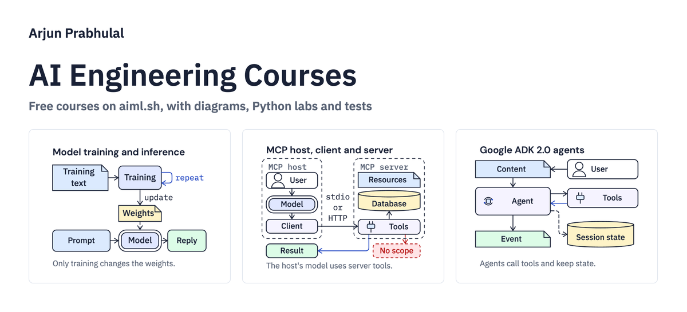
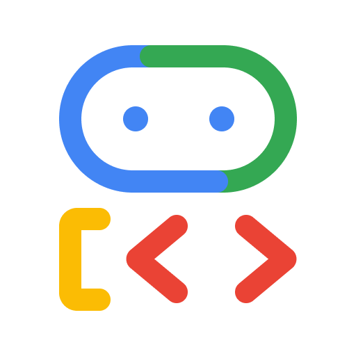
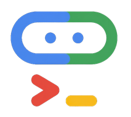

# Hey, I'm Arjun Prabhulal

Principal Engineer and Google Developer Expert (GDE) for Google Cloud and AI. I build AI agents, RAG systems and LLM apps on Google Cloud with ADK, Vertex AI, Gemini, and MCP, and write about what I learn along the way.

  
  
  
  
  

### Projects

Things I build and run.

-  **[aiml.sh](https://aiml.sh/)**: free AI engineering courses on LLMs, RAG and AI agents, plus MCP, inference and evals, with diagrams, runnable Python code and tests.
-  **[superPDF AI](https://superpdf.ai/)**: 68 free PDF tools that run in your browser, plus Chat with PDF with page citations and PDF agents you approve step by step. Files stay on your device.
-  **[@superpdf/cli](https://github.com/arjunprabhulal/superpdf)**: superPDF's open-source reader as a CLI, MCP server and local REST API (Apache-2.0). It turns PDFs into Markdown, HTML or JSON with headings, tables, charts as data and OCR in 15 languages, without a language model. Try it: `npx @superpdf/cli export report.pdf --output report.md`
-  **[Rivul AI](https://rivul.ai/)**: search 300M+ research papers, draft with sources attached, ask your own PDFs, scans and recordings with cited answers, and run research agents. Includes an MCP server and a REST API.
-  **[whatisai](https://whatisai.fyi/)**: learn AI five minutes at a time, with a 29-chapter course, a glossary of about 800 terms and a curated AI news edition every day at 7 PM ET.
-  **[openalex-semantic-search](https://github.com/arjunprabhulal/openalex-semantic-search)**: semantic search over 300M+ OpenAlex papers without a vector database, served from a single CPU server. It powers the paper search in Rivul AI.

### Courses on aiml.sh

17 free courses and 224 chapters, with diagrams, runnable Python code and tests.

| Track | Course | What you build | Chapters |
| --- | --- | --- | :---: |
| **Foundations** |  [AI Fundamentals](https://aiml.sh/courses/ai-fundamentals/) | Build the parts of a docs assistant: model requests, context, structured output, document ranking, validated tool calls and evaluations. | 11 |
|  |  [Build a Small Language Model From Scratch](https://aiml.sh/courses/llm-from-scratch/) | Build and inspect a small one-block transformer and its complete local training and generation path. | 11 |
|  |  [LLM Inference Engineering](https://aiml.sh/courses/llm-inference/) | Implement and inspect inference request handling, cache ownership, scheduling, measurement and capacity decisions using real local runs and clearly bounded experiments. | 20 |
|  |  [Building AI Systems](https://aiml.sh/courses/building-ai-systems/) | Choose, measure and improve an AI system against explicit quality, latency, cost and failure requirements. | 21 |
|  |  [Building MLOps](https://aiml.sh/courses/building-mlops/) | Take one user-return prediction application from a manual baseline through reproducible training, local release controls and outcome monitoring. | 21 |
| **Google&nbsp;ADK&nbsp;2.0** |  [Building Agents with Google ADK 2.0](https://aiml.sh/courses/google-adk/building-agents/) | Build agents, tools and multi-step workflows with Google ADK 2.0, then evaluate them. | 17 |
|  |  [Connecting Agents to Tools and Services with Google ADK 2.0](https://aiml.sh/courses/google-adk-integrations/) | Connect agents to BigQuery, databases through MCP Toolbox, Agent Search, Google Search and code execution, then add Skills and A2A. | 6 |
|  |  [Running and Deploying Agents with Google ADK 2.0](https://aiml.sh/courses/google-adk-production/) | Serve, observe, evaluate and deploy ADK agents with runtime controls, context caching, traces, simulated users, Cloud Run and Agent Runtime. | 20 |
|  |  [Building Live and Voice Agents with Google ADK 2.0](https://aiml.sh/courses/google-adk-live/) | Stream audio and screen frames with ADK live agents, handle tools and sessions, test voice callbacks, and build a custom WebSocket bridge. | 7 |
|  |  [Building, Evaluating, and Deploying Agents with Google Agents CLI](https://aiml.sh/courses/agents-cli/) | Scaffold, enhance, upgrade, evaluate, deploy, publish and observe ADK agents across the full Google Agents CLI lifecycle. | 6 |
| **Agents** |  [Building Agents with LangGraph](https://aiml.sh/courses/langgraph/) | Build and compare self-contained code-review agents and workflows with LangGraph: tools, stop conditions, context and token budgets, timeouts, checkpoints, idempotent retries, verified outcomes, human approval and memory. | 9 |
|  |  [Agent Design, Optimization and Harnesses](https://aiml.sh/courses/agent-engineering/) | Choose a control policy, improve it on separated task data and independently verify bounded local actions. | 9 |
|  |  [Context and Memory Engineering for AI Agents](https://aiml.sh/courses/context-and-memory/) | Assemble bounded model requests, compare context policies and maintain scoped memory with explicit provenance, retention and deletion rules. | 10 |
| **RAG, MCP and evals** |  [Retrieval-Augmented Generation (RAG)](https://aiml.sh/courses/rag/) | Build developer-document search with LangChain and pgvector, then answer from retrieved text and charts with checked source references. | 6 |
|  |  [Building Agentic RAG Applications](https://aiml.sh/courses/agentic-rag/) | Build a documentation assistant that answers from permitted, versioned sources. | 37 |
|  |  [Model Context Protocol (MCP)](https://aiml.sh/courses/mcp/) | Implement, test and secure MCP servers and clients, from stdio to a remote OAuth-protected service with scoped database access. | 7 |
|  |  [LLM Evals](https://aiml.sh/courses/llm-evaluation/) | Test LLM features with pytest and DeepEval, measure RAG and tool-call quality per stage, and gate prompt, model and dataset changes on regressions in CI. | 6 |

➡️ [Browse all courses](https://aiml.sh/courses/) · 📬 [Subscribe to the aiml.sh newsletter](https://aiml.sh/newsletter/) · 📰 [Latest AI news](https://whatisai.fyi/news/)

### Learning resources

- **[google-adk-masterclass](https://github.com/arjunprabhulal/google-adk-masterclass)**: 20 hands-on modules on ADK 1.x, from basics to advanced multi-agent topics. For ADK 2.0, see the courses on [aiml.sh](https://aiml.sh/).
- **[adk-vertex-ai-rag-engine](https://github.com/arjunprabhulal/adk-vertex-ai-rag-engine)**: a RAG agent built on Google ADK and Vertex AI RAG Engine, with semantic search over your documents in a couple of minutes.
- **[mcp-gemini-search](https://github.com/arjunprabhulal/mcp-gemini-search)** and **[mcp-flight-search](https://github.com/arjunprabhulal/mcp-flight-search)**: MCP servers that pair Gemini function calling with real-time flight search.

### Latest writing

<!-- BLOG-POST-LIST:START -->
- [How I Built Semantic Search Over 300 Million Plus Academic Papers](https://arjunprabhulal.com/how-i-built-semantic-search-300m-academic-papers/)
- [Building a Local, Multimodal AI Terminal Agent with Gemma 4](https://medium.com/google-developer-experts/building-a-local-multimodal-ai-terminal-agent-with-gemma-4-4fbaa50eb14b)
- [Building a RAG Agent with Google ADK, Antigravity SDK, Agent Skills, A2UI, and Gemini Enterprise…](https://medium.com/google-cloud/building-a-rag-agent-with-google-adk-antigravity-sdk-agent-skills-a2ui-and-gemini-enterprise-972c1f18f9be)
- [Four Layers of Agent Engineering](https://arjunprabhulal.com/graph-harness-loop-context/)
- [Top 30 AI/ML Terms Every Developer Should Know](https://arjunprabhulal.com/ai-ml-essential-terms/)
<!-- BLOG-POST-LIST:END -->

➡️ More on [arjunprabhulal.com/blog](https://arjunprabhulal.com/blog/) · [Medium](https://medium.com/@arjun-prabhulal)

### Speaking

- **Google DevFest Atlanta 2026** (Oct 30): From Spec to Shipping: Building AI Agents with Google ADK and Antigravity
- **ATLDevCon 2026** (Oct 17): From Spec to Shipping: Building AI Agents with Google ADK and Antigravity
- **AICamp Atlanta** (Aug 24): Building Multi-Agent Systems using Google ADK 2.0 and MCP

➡️ [All talks](https://arjunprabhulal.com/sessions/)
